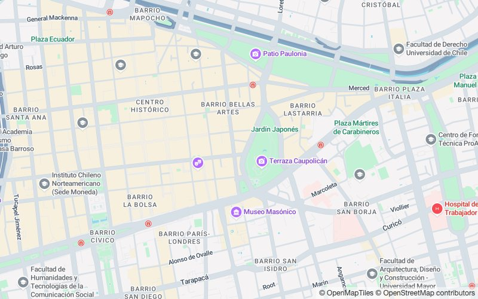
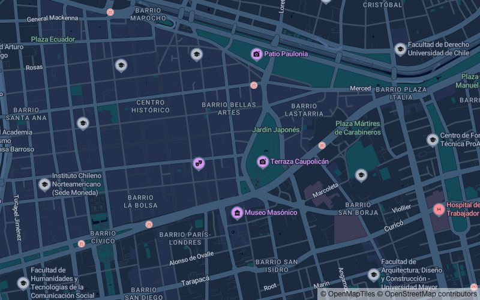
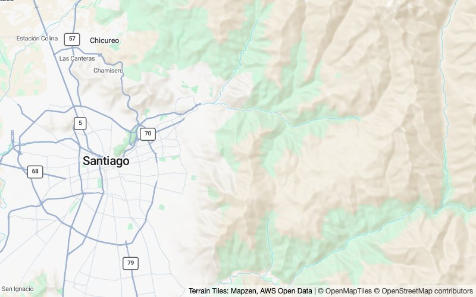
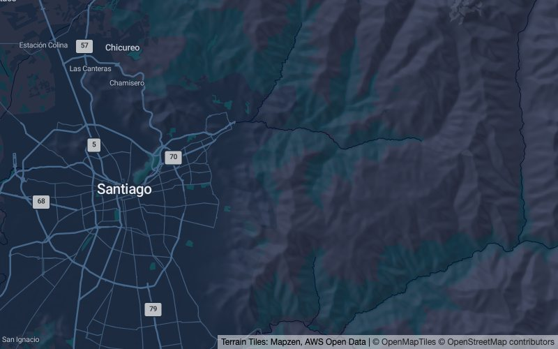
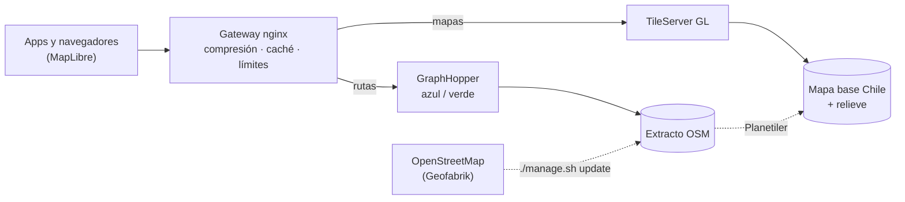

<h1 align="center">Buky-Mapas</h1>

<p align="center">
  Servidor propio de mapas vectoriales y cálculo de rutas para Chile, listo para clonar,
  instalar con un comando y mantener al día sin cortar el servicio.
</p>

<p align="center">
  
  
  
  
</p>

<table>
  <tr>
    <td></td>
    <td></td>
  </tr>
  <tr>
    <td></td>
    <td></td>
  </tr>
  <tr>
    <td align="center"><b>Light</b> · <code>cl-light</code></td>
    <td align="center"><b>Dark</b> · <code>cl-dark</code></td>
  </tr>
</table>

## Qué es

Buky-Mapas reúne en un solo repositorio todo lo necesario para servir mapas y rutas de Chile
desde tu propia infraestructura, sin depender de proveedores de mapas comerciales:

- **Mapas vectoriales** para [MapLibre](https://maplibre.org/) (web, Android, iOS) con dos
  estilos, **Light** y **Dark**: calles, edificios, parques, agua, relieve sombreado de la
  cordillera y lugares de interés por categoría.
- **Rutas en auto** con [GraphHopper](https://github.com/graphhopper/graphhopper), incluido un
  perfil que evita zonas que tú defines.
- **Datos de [OpenStreetMap](https://www.openstreetmap.org/)** que se actualizan con un comando,
  sin botar el servicio, y un informe de qué tan atrasados están frente a OSM.

## Características

| | |
|---|---|
| **Instalación en un comando** | Clonas en un Ubuntu Server (EC2, servidor propio o local) y `./manage.sh install` descarga y genera todo lo que falta. |
| **Actualización sin caída** | `./manage.sh update` trae el extracto nuevo de OSM, regenera mapa y rutas y los publica sin cortar el servicio. |
| **Al día con OSM** | `./manage.sh status` muestra la fecha de los datos y cuántos días de cambios faltan por bajar. |
| **Rápido y liviano** | Gateway con compresión, caché y límite de peticiones; el servidor de mapas usa ~45 MB de RAM. |
| **Portátil** | Corre en arm64 (AWS Graviton, Apple Silicon) y amd64, solo con Docker. |
| **Reproducible** | Estilos, íconos y fuentes viven en el repo; los datos pesados se reconstruyen desde fuentes públicas con verificación de integridad. |

## Inicio rápido

```bash
git clone https://github.com/Jose-Currinir/Buky-Mapas.git
cd Buky-Mapas
./manage.sh install --dev
```

Abre <http://localhost:8085/styles/cl-light/> o <http://localhost:8085/styles/cl-dark/>. La
primera instalación tarda unos 15 minutos (descarga OSM de Chile y genera el mapa); las
siguientes, segundos.

En un servidor, con tu dominio:

```bash
./manage.sh install --prod --url https://mapas.ejemplo.cl
./manage.sh programar   # actualización automática todos los domingos
```

Requisitos: Ubuntu Server 22.04 o superior (o macOS con Docker Desktop), ~5 GB de disco y RAM
según cómo se actualicen las rutas: **12 GB o más** para hacerlo sin caída (en AWS, **t4g.xlarge**),
o 8 GB con `ROUTING_ZERO_DOWNTIME=0` (unos minutos sin rutas al actualizar; **t4g.large**).

## Uso desde una app

```js
import maplibregl from "maplibre-gl";

const map = new maplibregl.Map({
  container: "map",
  style: "https://mapas.ejemplo.cl/styles/cl-light/style.json", // o cl-dark
  center: [-70.6505, -33.4378],
  zoom: 13,
});
```

Rutas (API de GraphHopper):

```bash
curl "https://rutas.ejemplo.cl/route?point=-33.45,-70.66&point=-33.42,-70.60&profile=car"
```

## Comandos

| Comando | Qué hace |
|---|---|
| `./manage.sh install [--prod\|--dev] [--url URL]` | Prepara el servidor y levanta todo. Se puede repetir sin riesgo. |
| `./manage.sh update` | Actualiza mapa y rutas desde OSM sin cortar el servicio. |
| `./manage.sh status` | Estado de los servicios y atraso de los datos frente a OSM. |
| `./manage.sh programar` | Programa la actualización semanal (systemd). |
| `./manage.sh rutas-volver` | Vuelve a la versión anterior de las rutas. |
| `./manage.sh up` / `down` / `logs` | Levanta, detiene o muestra registros. |
| `./manage.sh` | Menú interactivo. |

## Cómo funciona



- **Mapa:** al actualizar, el mapa nuevo se genera aparte; TileServer se recarga mientras el
  gateway responde desde su caché, y la caché se vacía cuando el mapa nuevo está listo.
- **Rutas:** una segunda instancia de GraphHopper importa los datos nuevos mientras la actual
  sigue atendiendo; cuando pasa una prueba real, el gateway cambia a ella en caliente.

En una actualización real se hicieron más de 5.000 peticiones mientras se publicaban mapa y rutas
nuevos, sin ningún error.

## Documentación

- [Operación](docs/operacion.md): instalación detallada, actualización, estilos, datos, rutas,
  configuración, scripts y rendimiento.
- [Atribuciones y licencias de terceros](docs/atribuciones.md).
- [`AGENTS.md`](AGENTS.md): guía para asistentes de código.

## Créditos

Los mapas usan datos de © [colaboradores de OpenStreetMap](https://www.openstreetmap.org/copyright)
y el esquema de © [OpenMapTiles](https://openmaptiles.org/). Cualquier mapa publicado con este
servicio debe mostrar esa atribución (MapLibre la muestra automáticamente). Detalle en
[atribuciones](docs/atribuciones.md).

## Licencia

Copyright 2026 Butake SpA. Publicado bajo la [Licencia Apache 2.0](LICENSE); ver también
[`NOTICE`](NOTICE). Los aportes son bienvenidos: lee [CONTRIBUTING.md](CONTRIBUTING.md).
